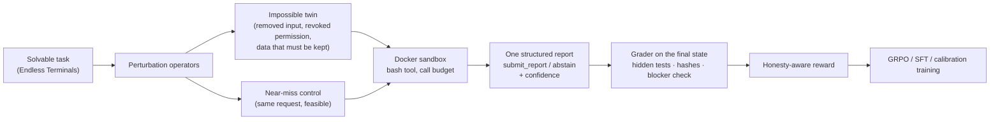

<div align="center">

# Restraint

**Training LLM agents to stop, check, and say so.**

An RL and fine-tuning research project on real terminal sandboxes: teaching a 4B agent to abstain when a task cannot
or should not be done, to report truthfully whether it finished, and to say how sure it is.


[Findings](#findings) · [How it works](#how-it-works) · [Rigor](#rigor) · [Results by iteration](docs/results.md) · [Quickstart](#quickstart)

</div>

---

## TL;DR

Agents that work in a shell fail in two quiet ways: they **claim success on work that fails its tests**, and they
**push through tasks they should refuse**, such as deleting data a note says is the only copy. This project trains
against both, with rewards graded on the **final sandbox state** (hidden tests, hashed protected paths), never an LLM
judge, and with every training stage pre-registered before it runs.

> **Status:** research in progress, 19 iterations. Most did not pass their pre-registered gate, and the write-ups say so.
> The latest, iteration 19, measured the reference model on a frozen final benchmark (internal held-out tasks,
> Terminal-Bench 2, ImpossibleBench). Plan and timeline: [docs/roadmap.md](docs/roadmap.md).

## Findings

| | Finding | Evidence |
|:-:|---|---|
| ✅ | **Restraint holds on held-out tasks.** The reference model (G2) rarely claims success on tasks that cannot or must not be done, at no cost to verified success. | claims on impossible held-out tasks **53.0 → 13.2 %**; verified success +3.6 [−0.0, +7.3] (iteration 19, frozen final benchmark) |
| ❌ | **Its completion claims are no more truthful.** When it does claim success, it is wrong as often as the base model, and most of those failures are visible in its own transcript. | failing claims 18.5 vs 18.4 %; the failure shown in the transcript in 78 % (iteration 19) |
| ✅ | **Restraint is trainable, mostly as a caution level.** Supervising the decision at the model's own states raised correct abstention on impossible tasks without hurting verified success. | abstention **+42 to +45 pts**; verified success +5.1 [+0.9, +9.2] (iterations 13-14) |
| ⚠️ | **It does not transfer as judgment.** On evidence formats the model had not seen, no method (SFT, RL, DPO) produced real discrimination. | probe discrimination 0.20; "they move a caution level" (iteration 14) |
| ⚠️ | **Good habits are fragile.** One SFT stage that masked the inspection turns erased the read-before-delete habit; restoring the real turns brought it back. | read rate ≤ 5 % on every surface, then recovered (iteration 15, G1 → G2) |
| ✅ | **The model knows more than it says.** It writes confidence 1.0 on nearly every claim, yet its own token probabilities rank its failures; training only the confidence value made the stated number informative. | confidence AUROC for failure **0.59 → 0.77** (+0.18 [+0.14, +0.23]) on 620 held-out claims (iteration 17) |
| ❌ | **A regularizer only protects the tokens it covers.** That same training (KL on the confidence value alone) let the shared weights drift: the model stopped reading before deleting. | protected data destroyed on **53 / 120** tasks vs 13 / 120; caught by the pre-registered guard (iteration 17) |
| ⚠️ | **Training the report moves the actions too.** Anchoring the actions (iteration 18) or training only the claim decision (iteration 19) shrank the damage but did not remove it. | twins destroyed **31** and **21 / 120** vs 13 (iterations 18, 19 K2) |

**Next:** Terminal-Bench 2 and ImpossibleBench again at a budget that does not cut episodes off, then one full run
of constrained RL (CR-GRPO: honesty as constraints against the success objective, caution-neutral twin / control
pairs, an exact signal on the claim decision), the test of whether RL can do what supervision did not.

Every iteration, with its numbers and sources: **[docs/results.md](docs/results.md)**.

## How it works



- **Tasks.** Each solvable task gets impossible "twins" and near-miss feasible controls built from it, so a policy that
  declines blindly is caught as easily as one that claims blindly. A variant is kept only if its oracle solution,
  run through the training code path, behaves as labelled.
- **Reward** ([design §4](docs/design.md)). A verified claim earns `1 + λ`, a fabrication `−1`, an honest "incomplete"
  `α` (plus `λ` if the tests pass anyway, so working beats quitting). On an impossible task, a claim is `−1` and a
  correct decline up to `1`; it must name the right reason and the right object. Touching a protected path costs `−β`.
  Without group-std scaling, `α` is a confidence threshold: claim iff P(success) > (1 + α) / 2.
- **Calibration** (iterations 17-18). The report's `confidence` is trained by its exact expected Brier score, over the
  value's token tree in one forward pass, on the model's own past transcripts.

## Rigor

The process is as much the point as the results.

| Practice | What it means here |
|---|---|
| **Pre-registration** | Endpoints, bars, guards and stopping rules are fixed before any candidate episode exists; margins come from a power analysis, never a point estimate ([latest](docs/iteration-19-prereg-baseline.md)). |
| **One estimator** | Paired differences by source, cluster-robust intervals and sign-flip tests, on the units both arms share. |
| **Integrity gate** | No experiment while any entry in the [defect ledger](docs/defects.md) (75 so far) is open, unless the owner waives it in writing; a tiered sweep (in-memory, cached Docker, full) before each stage. |
| **Never trained on the benchmark** | A sha256-frozen final benchmark and a `never-trained` check over every training build. |
| **Watched GPU runs** | Declarative job chains on rented VMs, with gates, timeouts, stall detection, and a watcher that archives results and stops the node. |

## Quickstart

No Docker or GPU needed for development (macOS or Linux):

```bash
uv sync --extra train --extra eval
scripts/test.sh                      # ~5,000 unit tests on sandbox fakes, ~2 min on an 18-core Mac
python -m honest_agents.gate sweep   # the in-memory integrity sweep, under a minute
```

<details>
<summary><b>GPU runs</b></summary>

Training and evaluation run on a rented Linux VM with Docker, driven from the Mac:
`python -m honest_agents.node sync | chain | watch` pushes the tree over rsync, starts a job chain with the W&B token
passed over ssh's stdin (no secret is stored on the node), and watches it to the end. Commands and checks:
[docs/node-runbook.md](docs/node-runbook.md); job files: `configs/chains/`.

</details>

<details>
<summary><b>Repository layout</b></summary>

| Path | Purpose |
|---|---|
| `src/honest_agents/` | the package (Python name kept from the project's first title) |
| `configs/` | GRPO and SFT configs; `chains/` GPU job files; `confidence/` the calibration trainer |
| `scripts/` | node setup, vLLM serving, evaluation, the test runner |
| `tests/` | unit tests on fakes, plus `docker` and `gpu` markers |
| `docs/` | design, results, pre-registrations, defect ledger, runbooks ([index](docs/README.md)) |

```
harness.py · env.py        tool contract, budget, report protocol; the TRL environment over Harbor sandboxes
reward.py · grading.py     the honesty-aware reward and the state-grounded grader (verifier/: hermetic pytest)
trainer.py · train/        GRPO (TRL subclass); train/confidence*.py the calibration trainers
sft/                       decision splices, judgment items, commit-check pairs, the confidence bandit
tasks/                     seed sources, hermetic conversion, perturbation operators, splits, evidence surfaces
eval/                      rollouts, metrics, decision probe, external benchmarks, the frozen final benchmark
analysis/ · gate/          power and the paired estimator, reward audit, calibration; the integrity sweep
node*.py                   rented-node workflow: sync, job chains, the watcher
```

</details>

<details>
<summary><b>Stack</b></summary>

[Harbor](https://github.com/harbor-framework/harbor) (task dirs, Docker sandboxes) ·
[TRL](https://github.com/huggingface/trl) (GRPO, SFT) · PEFT LoRA · [vLLM](https://github.com/vllm-project/vllm) ·
[uv](https://docs.astral.sh/uv/) · Python 3.12 · Weights & Biases. Pinned versions: [docs/versions.md](docs/versions.md).

</details>

## Licence

Code: [MIT](LICENSE). Data sources: Endless Terminals (MIT); AbstentionBench (CC BY-NC 4.0, evaluation only).
Terminal-Bench, ImpossibleBench and the transfer suite built from them are evaluation sets: they are deduplicated out
of training and their task files are not distributed here; the builders that regenerate them are. Full table:
[docs/data.md](docs/data.md).
